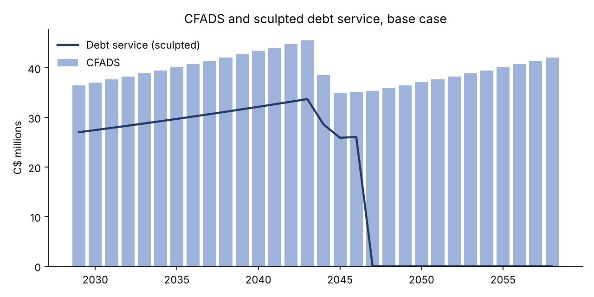
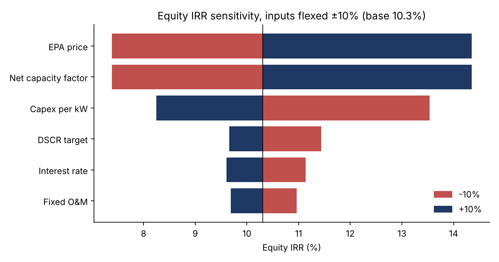

# Coastal Ridge Wind: Project Finance Model

An Excel project finance and valuation model for a hypothetical 200 MW BC wind farm with a 30 year BC Hydro EPA. Debt is sculpted to a target DSCR. A VBA macro resolves the tax circularity, and a Python version of the model reconciles every line.

**Base case:** $600M capex · $338M sculpted senior debt (56% gearing) · 10.3% equity IRR · 1.35x DSCR · breakeven EPA price $70.93/MWh vs $74 awarded



## What's inside

| Path | What it is |
|---|---|
| `model/BC_Wind_Project_Finance.xlsx` | The model: Inputs, Model, Outputs, Sensitivity. About 1,500 live formulas and named ranges, with a scenario selector |
| `vba/ModelMacros.bas` | `SculptDebt` (circularity breaker), `RunSensitivities` (tornado), `RunTwoWay` (price by capacity factor grid), `BreakevenPrice` (bisection) |
| `src/pfmodel.py` | Python version of the model, line for line |
| `src/sensitivity.py` | Tornado, two way grid, breakeven price, charts |
| `src/build_workbook.py` | Rebuilds the workbook from the Python inputs |
| `tests/` | 34 tests: integrity checks for each scenario, plus Excel to Python reconciliation through LibreOffice |
| `docs/investment_memo.md` | Two page financing and valuation memo |

## Modelling approach

- **Revenue:** capacity × 8,760 h × net capacity factor × availability × degradation, priced at the EPA rate ($74/MWh in 2024$, indexed to CPI).
- **Debt sizing:** each year, debt service = CFADS ÷ target DSCR. Debt = the lower of the PV of that sculpted schedule at the debt rate and the gearing cap.
- **Tax:** 27% BC combined rate, Class 43.2 CCA at 50% declining balance, loss carryforward. The 30% Clean Technology ITC reduces the UCC pool.
- **Circularity:** sizing uses after tax CFADS, but tax depends on interest. `SculptDebt` pastes tax as values and iterates, which is the usual approach in lender models, instead of turning on Excel's iterative calculation. Outputs!Checks flags a stale paste.
- **Checks:** sources = uses, debt fully repaid, circularity converged, DSCR ≥ target.

## Results

| | Upside | Base | Downside |
|---|---|---|---|
| Equity IRR | 18.6% | 10.3% | 4.9% |
| Gearing | 68% | 56% | 41% |
| Equity NPV at 9% ($M) | 96.1 | 20.8 | (99.8) |



## Run it

```bash
pip install -r requirements.txt
python src/pfmodel.py            # scenario summary
python src/sensitivity.py        # tornado, grid, breakeven, charts
python -m pytest -q              # 34 tests (reconciliation needs LibreOffice)
```

In Excel: save as `.xlsm`, then Alt+F11 > File > Import File > `vba/ModelMacros.bas`. Run `SculptDebt` after any input change, or `RunAll` to also refresh the sensitivities.

## Simplifications and next steps

No interest during construction, DSRA, upfront fees, curtailment or decommissioning. The ITC is received in operating year 1 with no bridge loan. Equity is modelled at 100% project level. Next steps:
1. ITC bridge facility and IDC during construction
2. First Nations partnership waterfall (51 / 49) with a separate partner IRR
3. P90 debt sizing alongside P50
4. Monthly or semi annual debt periods

## Sources

- BC Government, BC Hydro 2024 Call for Power selections (Dec 2024): https://news.gov.bc.ca/releases/2024ECS0048-001643
- $74/MWh weighted average levelized price (2024$), about 4,830 GWh/yr: https://myeastkootenaynow.com/?p=43673

*Hypothetical asset; assumptions are illustrative. Not investment advice.*
# bc-wind-project-finance
